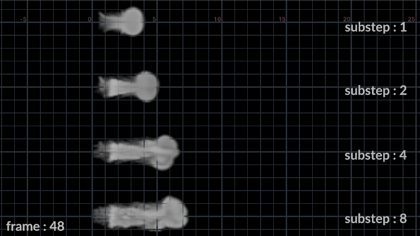
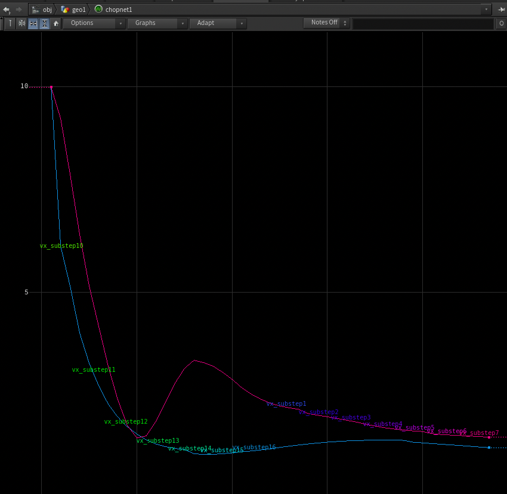
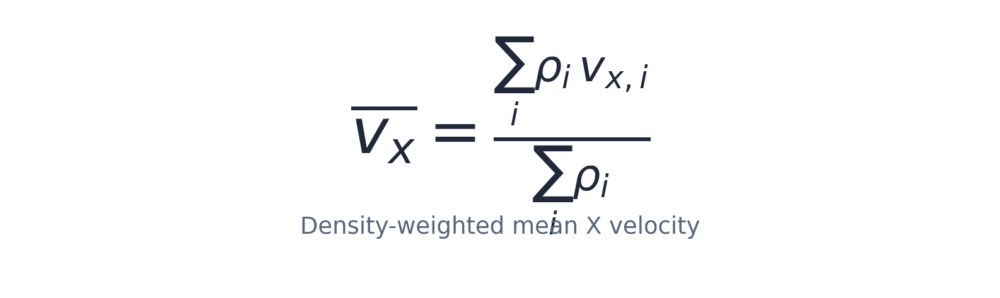
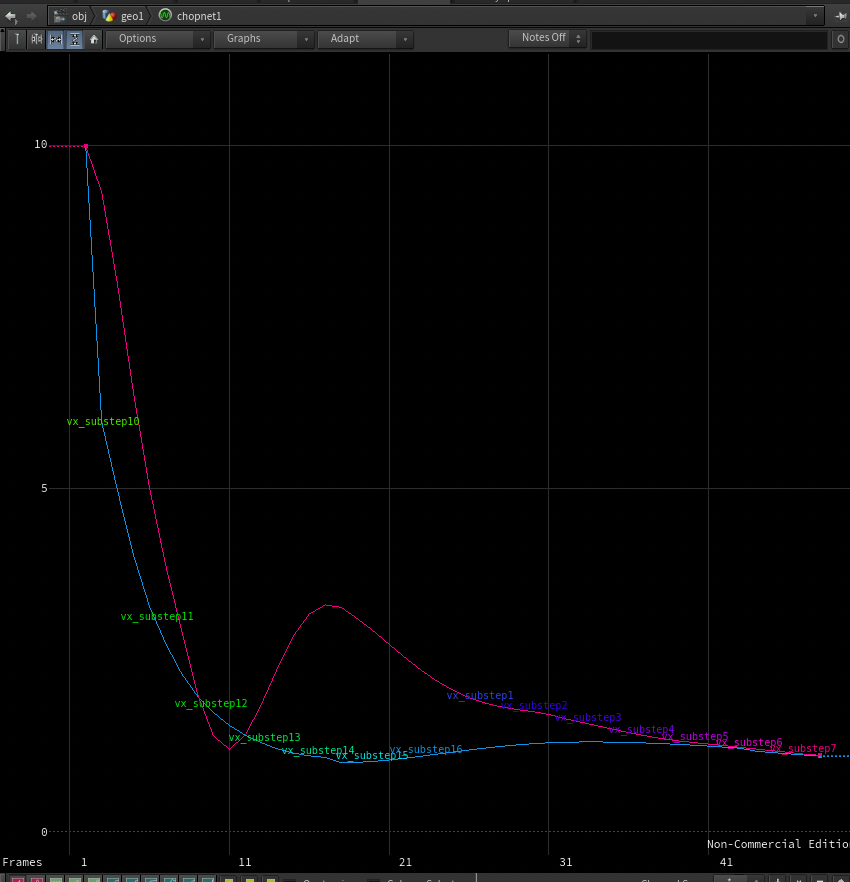
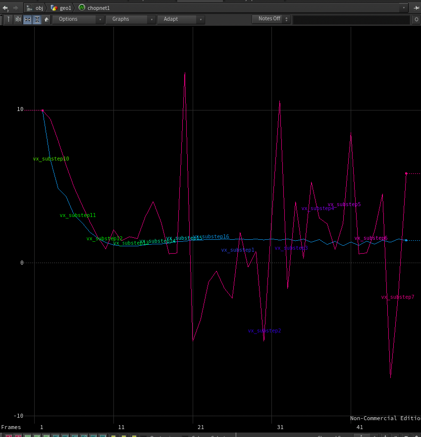

## Substeps는 언제 사용하는 걸까?

## When should we use Substeps?

Houdini에서 Substeps는 한 프레임 사이의 시간을 몇 번으로 나눠 계산할 것인지 정하는 값이다.

In Houdini, Substeps controls how many smaller time steps are used to calculate one frame.

보통 Pyro나 Particle 시뮬레이션에서 빠른 이동이나 강한 velocity 때문에 결과가 계단처럼 끊어져 보일 때 먼저 떠올리는 설정 중 하나다. 프레임 사이에서 놓치는 움직임을 조금 더 촘촘하게 계산하기 위해서다. Rigid Body에서는 빠른 물체의 충돌을 더 세밀하게 계산할 때도 사용한다.

We often think about Substeps when a Pyro or Particle simulation looks stepped or broken because the source is moving too fast or has strong velocity. By using more Substeps, the simulation can calculate what happens between frames more often. For Rigid Body simulations, Substeps can also help calculate fast collisions more accurately.

그렇다면 Substeps를 무조건 높이면 더 정확하고 자연스러운 결과가 나올까? 궁금해서 간단한 Test를 해봤다.

But does increasing Substeps always give us a more accurate and natural result? I was curious, so I decided to run a simple test.

## 실무에서는 생각보다 잘 해결되지 않았다

## In production, Substeps did not solve the problem as often as I expected

시작은 initial velocity가 강한 Pyro 시뮬레이션이었다. 그런데 내 기준으로는 실무에서 계단 현상이 생겼을 때 Substeps만 높여서 문제가 해결된 적은 거의 없었다.

This started with a Pyro simulation that had strong initial velocity. From my experience, increasing Substeps alone has almost never fixed the stepping problem in production.

항상 먼저 Substeps를 확인해 보긴 하지만, 결국 emitter를 이동 방향으로 길게 만들거나 프레임 사이 거리를 계산해서 중간에 파티클을 추가하는 식으로 해결하는 경우가 많았다.

I usually check Substeps first. But in the end, I often need to stretch the emitter in the direction of movement, or calculate the distance between frames and add extra particles in between.

그럼 Substeps는 정확히 무엇을 바꾸는 걸까?

So what does Substeps actually change?

## Test 01 — Substeps 1 / 2 / 4 / 8

같은 sphere 소스를 이용해 Pyro 시뮬레이션 네 개를 만들었다. Voxel Size는 0.1, 초기 velocity는 `{10, 0, 0}`으로 설정했다. Density와 velocity는 첫 프레임에만 소싱했다. Velocity는 Copy 방식으로 입력했지만, 시뮬레이션 내내 10으로 고정한 것은 아니다.

I made four Pyro simulations using the same sphere source. The Voxel Size was 0.1, and I set the initial velocity to `{10, 0, 0}`. Density and velocity were sourced only on the first frame. I used Copy for velocity sourcing, but that does not mean the velocity stayed at 10 during the whole simulation.


내 예상은 움직임의 부드러움 정도가 달라질 거라는 것이었다. 그런데 결과는 달랐다. Substeps가 1에서 8로 높아질수록 연기가 더 멀리 이동했다.

I expected the main difference to be how smooth the movement looked. But the result was different. As I increased Substeps from 1 to 8, the smoke traveled farther.



*Frame 48 — Substeps 1 / 2 / 4 / 8 비교*

*Frame 48 — Comparison of Substeps 1 / 2 / 4 / 8*

같은 소스, 같은 초기 속도인데 왜 이렇게 멀리 갈까? 처음에는 단순히 density 모양만 달라진 것인지 궁금했다.

The same source and the same initial velocity, but why did the smoke travel so much farther? At first, I wondered if only the density shape was different.

## 그래서 velocity도 측정해 봤다

## So I measured the velocity too

연기가 있는 곳에서 X 방향 velocity가 어떻게 변하는지 보기 위해 density-weighted X velocity를 계산했다. Density가 많은 곳에 더 큰 가중치를 준 평균값이다.

I calculated density-weighted X velocity to see how the X velocity changed where the smoke was. This is an average velocity that gives more weight to areas with higher density.

그래프를 보니 Substeps 1은 속도가 빠르게 떨어지고 낮은 값으로 유지됐다. 반면 Substeps 8은 처음에 감소했다가 중간에 다시 올라가는 구간이 있었다. 멀리 이동한 결과와 맞아떨어지는 부분이다.

In the graph, Substeps 1 lost velocity quickly and stayed at a low value. But Substeps 8 also dropped at first, then went up again for a while. This matched the result where the smoke traveled farther.



*Density-weighted X velocity 비교*

*Comparison of density-weighted X velocity*


### Density-weighted X velocity 계산 방법

### How I calculated density-weighted X velocity

연기가 있는 위치의 X velocity를 하나의 값으로 비교하려고, 각 voxel의 X velocity에 그 위치의 density를 곱한 다음 모두 더했다. 마지막으로 전체 density의 합으로 나눴다. Density가 많은 부분의 속도가 평균에 더 크게 반영되는 방식이다.

To compare the X velocity in the smoke, I multiplied each voxel's X velocity by its density, added the results together, and divided by the total density. This gives more weight to the velocity in areas with more smoke.



*Density-weighted X velocity 계산식 — rho: density, vx: X velocity, i: voxel index*

*Density-weighted X velocity formula — rho: density, vx: X velocity, i: voxel index*

아래는 같은 계산식을 Houdini에서 구현할 수 있도록 정리한 **참고용 Attribute Wrangle 코드**다. `Run Over: Detail (only once)`로 사용하며, 입력에는 `density`와 `vel` 볼륨이 있어야 한다.

Below is a **reference Attribute Wrangle example** for the same calculation. Set `Run Over` to `Detail (only once)` and provide `density` and `vel` volumes as input.

```vex
// Reference implementation; run once over Detail.
// Input 0: density (scalar volume/VDB), vel (vector volume/VDB)
vector res = volumeres(0, "density");
vector origin = volumeindexorigin(0, "density");
float weighted_sum = 0.0;
float density_sum = 0.0;

for (int k = int(origin.z); k < int(origin.z + res.z); k++)
{
    for (int j = int(origin.y); j < int(origin.y + res.y); j++)
    {
        for (int i = int(origin.x); i < int(origin.x + res.x); i++)
        {
            vector index = set(i, j, k);
            float rho = max(0.0, volumeindex(0, "density", index));
            if (rho <= 0.0) continue;

            vector pos = volumeindextopos(0, "density", index);
            vector vel = volumesamplev(0, "vel", pos);
            weighted_sum += rho * vel.x;
            density_sum += rho;
        }
    }
}

f@density_weighted_vx = density_sum > 0.0
    ? weighted_sum / density_sum : 0.0;
```

이 코드는 density voxel의 중심에서 velocity를 샘플링해 평균을 계산한다. `density`와 `vel`의 voxel 해상도가 달라도 같은 위치를 기준으로 값을 읽는 방식이다. 단, 모든 density voxel의 부피가 같다고 가정하며, 음수 density는 0으로 처리한다. 실제 기존 그래프와 완전히 같은 값이 나오는지는 기존 측정 방식과 비교해야 한다.

This code samples velocity at the center of each density voxel. It uses the same positions even if `density` and `vel` have different voxel resolutions. It assumes the density voxels have the same volume and treats negative density as zero. To know whether it matches my original graph exactly, I would need to compare it with the original measurement setup.

## 그런데 Substeps가 단순히 계산 횟수만 늘리는 건 아니었다

## But Substeps does more than just increase the number of calculations

관련 자료를 찾아보니 Pyro는 단순히 연기를 현재 위치에서 다음 위치로 옮기는 시스템이 아니었다. Velocity field 자체가 시간에 따라 계속 변하고, density는 그 변화하는 velocity field를 따라 움직인다. 이 과정에는 Velocity Advection, Pressure Projection 같은 여러 계산이 들어간다.

After reading more about it, I learned that Pyro does not simply move smoke from one position to the next. The velocity field itself keeps changing over time, and density moves with that changing velocity field. Several calculations are involved, including Velocity Advection and Pressure Projection.

그러니까 같은 한 프레임이라도 Substeps 1과 8은 velocity와 density가 변하는 과정을 서로 다른 시간 간격으로 계산하는 셈이다. 시작 조건이 같아도 결과가 달라질 수 있다는 이야기다. 그렇다고 이것만으로 왜 Substeps 8이 더 멀리 가는지 설명이 끝나는 건 아니다. 그래서 몇 가지 설정을 바꿔서 Test해 봤다.

So even for the same frame, Substeps 1 and 8 calculate the changes in velocity and density using different time intervals. That means the results can be different, even with the same starting conditions. But this still does not explain exactly why Substeps 8 traveled farther. So I changed a few settings and tested again.

## Test 02 — Advection Scheme 변경

## Test 02 — Changing the Advection Scheme

Velocity Advection을 Semi-Lagrangian에서 Modified MacCormack으로 바꿔봤다. 그런데 Substeps 1과 8의 속도 차이는 여전히 남았다. 특정 advection scheme 하나만의 문제라고 보기 어려웠다.

I changed Velocity Advection from Semi-Lagrangian to Modified MacCormack. But the velocity difference between Substeps 1 and 8 was still there. So it was hard to say that one advection scheme was the only cause.

## Test 03 — Sparse에서 Dense로

## Test 03 — From Sparse to Dense

혹시 Sparse 영역 처리 때문인가 싶어서 Dense로도 돌려봤다. 하지만 Dense에서도 비슷한 차이가 나타났다. 특히 Substeps 8은 속도가 다시 올라가는 구간이 남아 있었다.

I wondered if the Sparse simulation was causing this, so I also tested Dense. But I saw a similar difference in Dense. Substeps 8 still had a period where the velocity went up again.



*Dense 시뮬레이션에서의 velocity 비교*

*Velocity comparison in the Dense simulation*

## Test 04 — Pressure와 Advection-Reflection

## Test 04 — Pressure and Advection-Reflection

Pressure를 시각화했을 때는 Substeps 1에서 Frame 2와 17 부근에 갑자기 강해지는 부분이 보였고, Substeps 8은 상대적으로 큰 변화가 없어 보였다. 다만 화면에 보이는 pressure의 세기만으로 velocity 변화의 원인을 판단할 수는 없었다.

When I looked at the pressure field, Substeps 1 seemed to show sudden increases around Frames 2 and 17. Substeps 8 looked more steady. However, I could not find the cause of the velocity difference just by looking at the pressure values in the viewport.

Advection-Reflection을 Single-Project로 바꾸자 이번에는 Substeps 8의 평균 X velocity가 크게 위아래로 튀었다. 원래 결과를 설명하기보다 계산 방식이 바뀌면서 다른 거동이 나타난 셈이다.

When I changed Advection-Reflection to Single-Project, the average X velocity for Substeps 8 started jumping up and down a lot. Rather than explaining the original result, this showed a different behavior after changing the calculation method.



*Single-Project 적용 후 velocity 변화*

*Velocity changes after using Single-Project*

## 그래서 결론은?

## So, what did I find?

솔직히 이번 Test에서 정확히 어느 계산이 이동 거리 차이를 만들었는지까지 찾아내지는 못했다. 파고들수록 내가 아는 범위만으로는 구분하기 어려운 부분이 있었다.

To be honest, I could not find exactly which calculation caused the difference in travel distance. The more I looked into it, the harder it became to separate the different effects with what I know right now.

그래도 이번 Test로 확인한 건 있다. Substeps를 높이면 velocity advection이나 pressure projection을 포함한 필드 계산이 더 작은 시간 간격으로 진행된다. 그러면서 velocity가 시간에 따라 변해 온 과정, 즉 velocity history도 달라질 수 있다. 이번에는 Substeps 8에서 density-weighted X velocity가 더 높게 나타난 구간이 있었고, 연기도 더 멀리 이동했다. 다만 정확히 어느 계산이 얼마나 영향을 줬는지는 여전히 모른다.

Still, I did learn something from this test. With more Substeps, field calculations, including Velocity Advection and Pressure Projection, happen over smaller time intervals. Because of this, the way velocity changes over time—its velocity history—can also be different. In this test, Substeps 8 had higher density-weighted X velocity during some frames, and the smoke traveled farther.

여기서 density-weighted X velocity는 전체 velocity field의 운동량이 아니다. 연기가 있는 영역의 가중평균 속도이기 때문에, velocity 자체가 달라진 영향뿐 아니라 density가 어디에 얼마나 분포하는지도 값에 영향을 준다.

One thing to keep in mind is that density-weighted X velocity is not the momentum of the whole velocity field. It is a weighted average in the areas where smoke exists. So the value can change because of the velocity itself, but also because of where the density is distributed.

이번 Test를 통해 정리해 보면 다음과 같다.

Here is what I learned from these tests.

1. Substeps를 높인다고 연기가 반드시 더 멀리 이동하는 것은 아니다. 이번 조건에서 그렇게 나온 것이다.

   Increasing Substeps does not always make smoke travel farther. That is what happened under the conditions of this test.

2. Substeps는 시간적 부드러움만 바꾸는 옵션이 아니다. 필드 계산 결과와 움직임 자체가 달라질 수 있다.

   Substeps does not only change how smooth the movement looks. It can also change the field calculations and the movement itself.

3. Sparse에서만 생기는 현상은 아니었다. Dense에서도 비슷한 velocity 차이가 나타났다.

   This did not happen only in Sparse. I saw a similar velocity difference in Dense too.

4. Velocity Advection과 Pressure Projection 모두 영향을 줄 가능성은 있지만, 각각의 기여를 따로 확인하지는 못했다.

   Velocity Advection and Pressure Projection may both affect the result, but I could not measure their effects separately.

또 하나 궁금한 건 수렴 여부다. Substeps 1 → 2 → 4 → 8로 갈수록 계속 멀리 이동했다고 해서 8이 가장 정확한 결과라는 뜻은 아니다. Substeps를 더 높였을 때 차이가 점점 줄어드는지, 즉 Time-step Convergence가 나타나는지는 이번 Test에서 확인하지 않았다.

Another question is convergence. Just because the smoke traveled farther as I increased Substeps from 1 to 2 to 4 to 8 does not mean 8 is the most accurate result. I did not test whether the difference becomes smaller at higher Substeps, which is called Time-step Convergence.

결국 Substeps는 단순히 결과를 더 부드럽게 만드는 설정이라기보다, 시뮬레이션이 시간을 나눠 계산하는 방식을 바꾸는 설정이라는 생각이 들었다. 앞으로도 무조건 값을 높이기보다는 내가 해결하려는 문제가 뭔지, 그 변경으로 실제 결과가 어떻게 달라지는지 먼저 확인해야겠다. 첫 번째 FX Note는 여기까지.

In the end, I think Substeps is not just a setting to make a simulation look smoother. It changes how the simulation divides time for its calculations. Next time, instead of simply increasing the value, I want to check what problem I am trying to solve and how the result actually changes. That is all for my first FX Note.

## 참고 자료

## References

SideFX — Pyro Solver SOP: https://www.sidefx.com/docs/houdini/nodes/sop/pyrosolver.html

SideFX — Pyro Background: https://www.sidefx.com/docs/houdini/pyro/background.html

SideFX — VEX volumeindex: https://www.sidefx.com/docs/houdini/vex/functions/volumeindex.html

SideFX — VEX volumeindexorigin: https://www.sidefx.com/docs/houdini/vex/functions/volumeindexorigin.html

SideFX — VEX volumeindextopos: https://www.sidefx.com/docs/houdini/vex/functions/volumeindextopos.html

SideFX — VEX volumesamplev: https://www.sidefx.com/docs/houdini/vex/functions/volumesamplev.html

*The weighted-average formula is the standard definition of a weighted mean applied to voxel density and X velocity; it is not a formula quoted from SideFX.*

영문 작성은 AI의 도움을 받아 작성되었습니다.
English translation was written with the help of AI.
