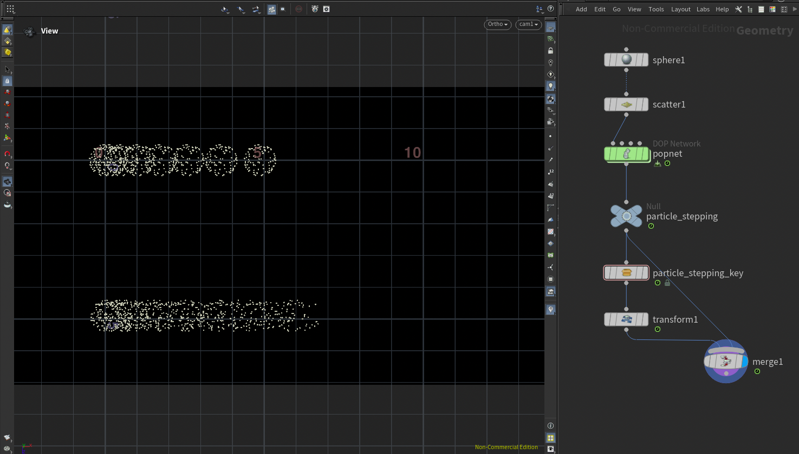

빠르게 움직이는 파티클에서 발생하는 Stepping 현상을 시뮬레이션 Substeps를 높이지 않고 완화하는 HDA입니다.

Reduce visible stepping artifacts in fast-moving particle simulations without increasing simulation substeps.

파티클의 Velocity 속성(`v`)을 기반으로 파티클의 이동 거리를 조절해 Stepping 현상을 완화합니다.

This HDA reduces stepping by adjusting how far each particle moves, based on its velocity attribute (`v`).

*Houdini에서의 Particle Stepping 비교*

*Particle stepping comparison in Houdini*

## 설치

## Install

1. Houdini에 `.hdanc` 에셋 라이브러리를 설치합니다.

   Install the `.hdanc` asset library in Houdini.

2. 파티클 시뮬레이션 뒤에 HDA를 연결합니다.

   Connect the HDA after the particle simulation.

3. 입력 파티클에 유효한 `v` 속성이 있는지 확인합니다.

   Ensure the input particles have a valid `v` attribute.

## 파일

## Files

- [`sop_mac.Particle_Stepping_key.1.0.hdanc`](./particle-stepping/sop_mac.Particle_Stepping_key.1.0.hdanc) — HDA (비상업용)

  HDA (Non-Commercial)

- [`particle_stepping_example_key.hipnc`](./particle-stepping/particle_stepping_example_key.hipnc) — 예제 프로젝트

  Example project

## 변경 내역

## Changelog

- **v1.0** — 비상업용 첫 배포.

  Initial non-commercial release.
